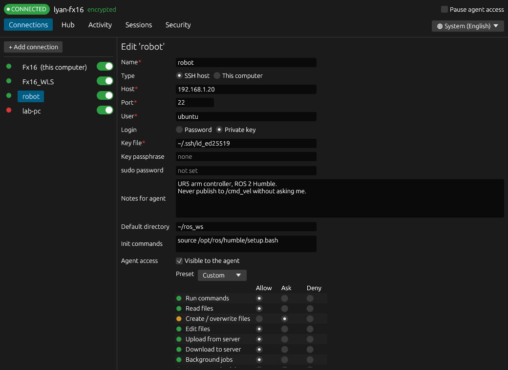
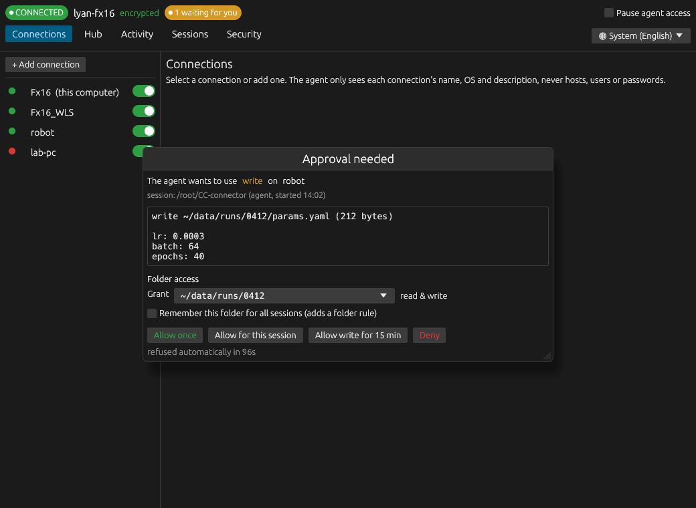
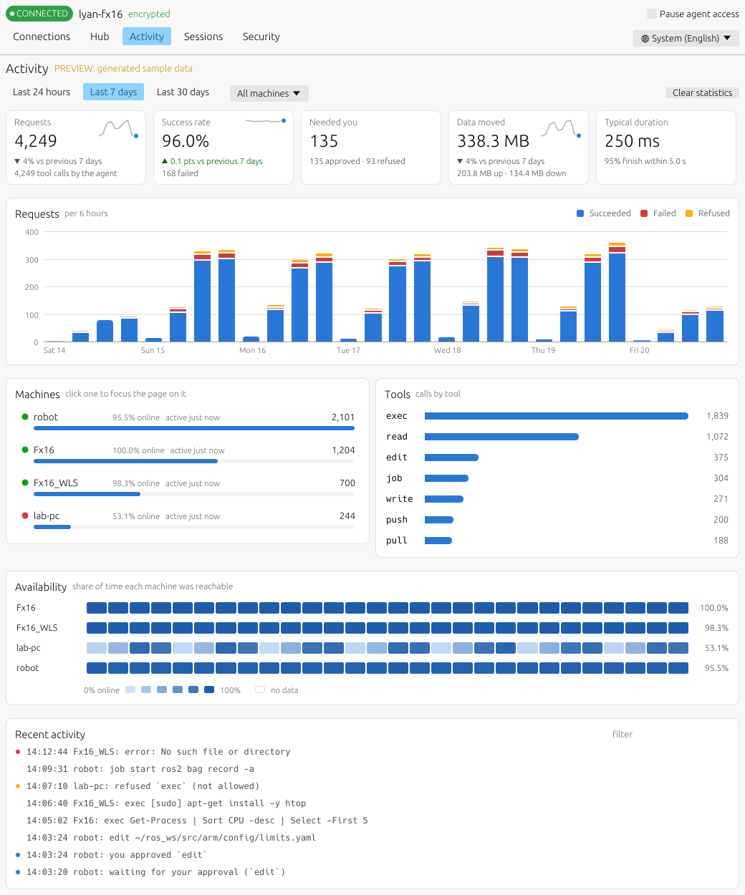
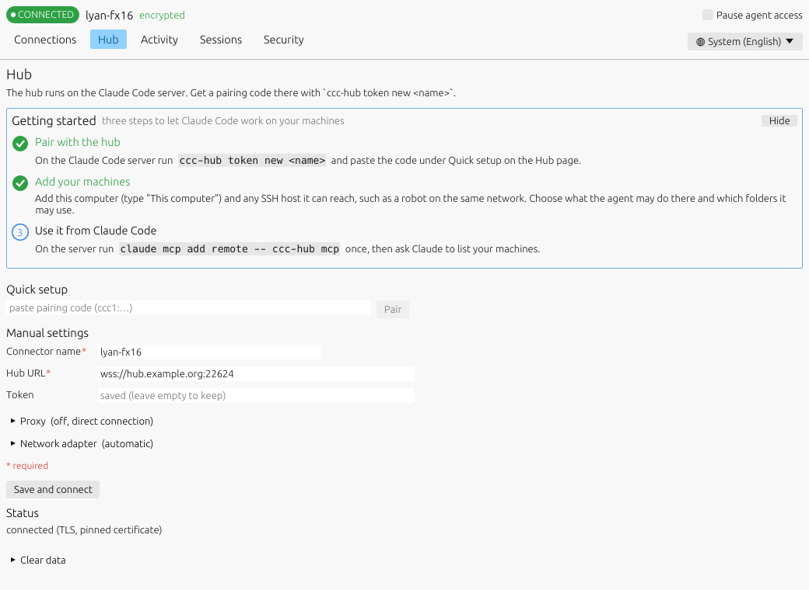
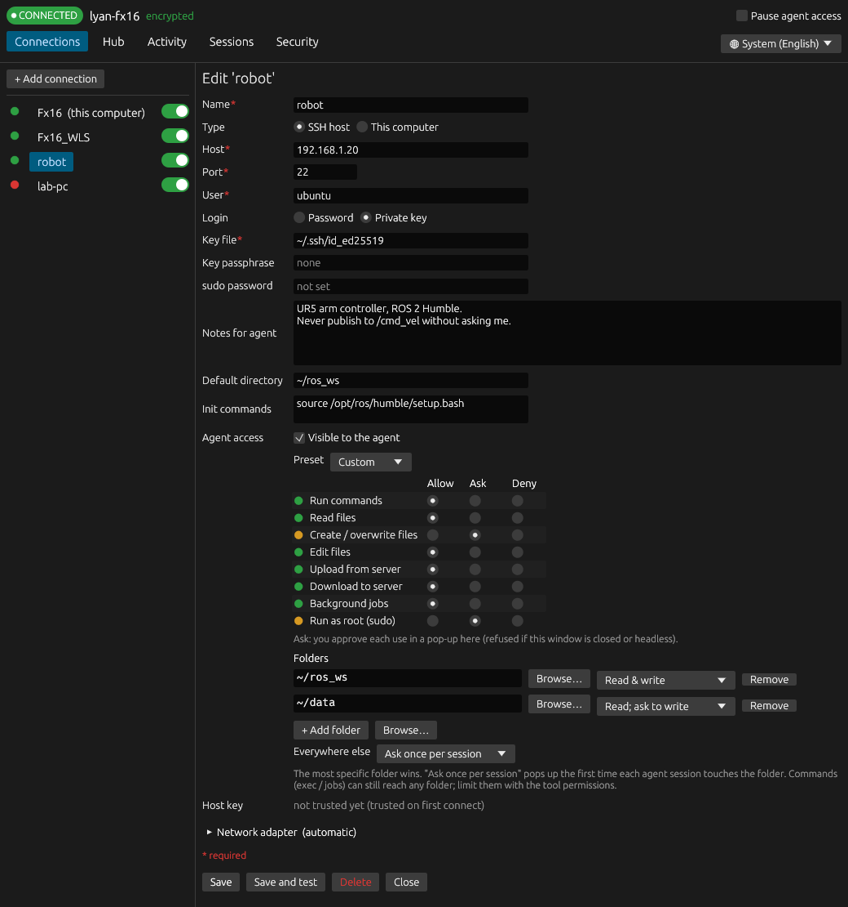
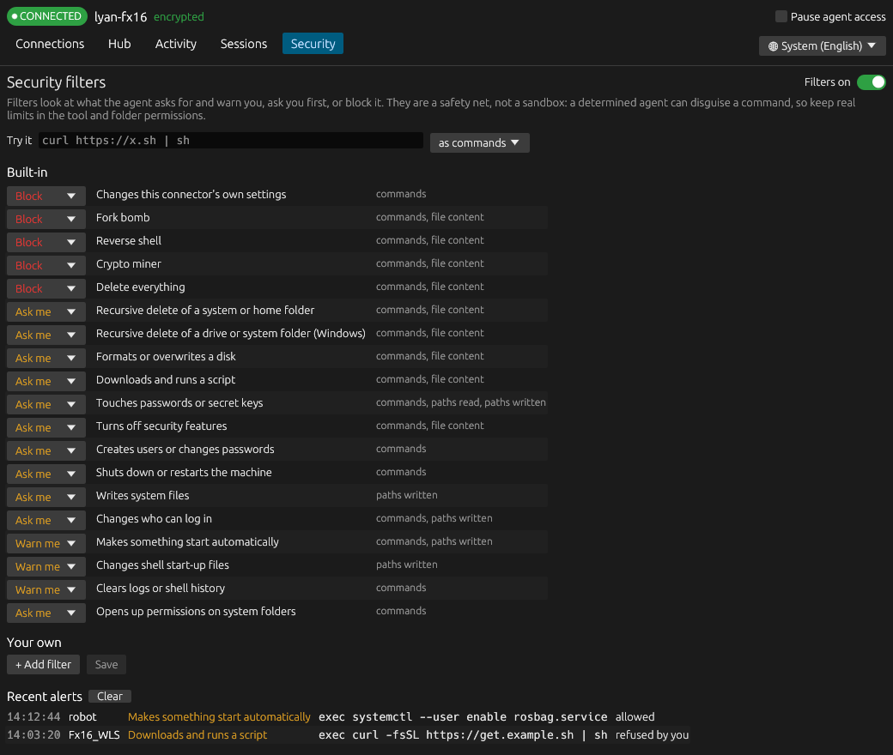

# CC-connector

Let **Claude Code** running on a server work on other machines (your Windows or Ubuntu laptop,
WSL, a robot computer on the laptop's LAN) **without installing Claude Code on them**, and
without ever showing the agent an IP address, user name or password.

```
 Claude Code ──MCP (stdio)──> ccc-hub mcp ──unix socket──> ccc-hub serve        ← server
                                                                ▲
                                     WebSocket over TLS, dialled OUT by the laptop
                                                                │
                      laptop:  ccc   (GUI · CLI · headless) ────┘
                                 ├─ "This computer"   → runs commands on the laptop (PowerShell / bash)
                                 └─ SSH connections   → WSL, robot, any LAN host (nothing installed there)
```

| Part | Runs on | What it does |
|---|---|---|
| `ccc-hub` | the Claude Code server | Accepts connectors, gives Claude 9 MCP tools, routes requests |
| `ccc` | your laptop | Stores connections (passwords in the OS keyring), dials the hub, executes requests |

The agent only sees each machine's **name, OS, status, access rules and your notes**. You decide,
per machine and per tool, what it may do: allow, ask you first, or deny.

**Download:** [latest release](https://github.com/Lyan9145/CC-connector/releases/latest)
(Windows and Linux connector, Linux hub).

## Screenshots

| Your machines, with a status dot and a show/hide switch for each | Approving a write to a folder you set to *ask* |
|---|---|
|  |  |
| **Activity:** what the agent did, per machine and per tool | **Hub:** pairing, with the getting-started guide |
|  |  |

The screenshots use sample data. The window follows the system light or dark theme.

---

## Contents

- [Screenshots](#screenshots)
- [Quick start](#quick-start)
- [Full guide](#full-guide)
  - [1. Server: the hub](#1-server-the-hub) ([sharing the hub between users](#sharing-the-hub-between-users))
  - [2. Laptop: the connector](#2-laptop-the-connector) ([proxy](#proxy), [network adapter](#network-adapter), [clear data](#clear-data))
  - [3. Adding machines](#3-adding-machines) ([notes for the agent](#notes-for-the-agent), [permissions](#permissions), [folders](#folders), [security filters](#security-filters), [MCP servers on the laptop](#mcp-servers-on-the-laptop))
  - [4. Using it from Claude Code](#4-using-it-from-claude-code)
- [Agent tools reference](#agent-tools-reference)
- [Security model](#security-model)
- [Command reference](#command-reference)
- [Files and environment variables](#files-and-environment-variables)
- [Troubleshooting](#troubleshooting)
- [Limits](#limits)
- [Building from source](#building-from-source)

---

## Quick start

You need: a Linux server running Claude Code that your laptop can reach on one TCP port, and
the release files `ccc-hub-linux-x86_64` (server) and `ccc-windows-x86_64.exe` or
`ccc-linux-x86_64` (laptop) from the [Releases page](https://github.com/Lyan9145/CC-connector/releases/latest).

### On the server (as root)

```bash
install -m755 ccc-hub-linux-x86_64 /usr/local/bin/ccc-hub

# where the laptop will reach the hub (pick any free port, open it in your firewall)
ccc-hub config --listen 0.0.0.0:22624 --public-url wss://your.server.com:22624
ccc-hub tls self-signed                       # encrypted, no CA or domain validation needed

ccc-hub print-systemd > /etc/systemd/system/ccc-hub.service
systemctl daemon-reload && systemctl enable --now ccc-hub

ccc-hub token new laptop                      # prints a PAIRING CODE (ccc1:…), shown once

claude mcp add remote --scope user -- /usr/local/bin/ccc-hub mcp
```

### On the laptop

1. Run `ccc-windows-x86_64.exe` (Windows may warn that the file is unsigned: *More info → Run
   anyway*) or `./ccc-linux-x86_64` on Ubuntu.
2. **Hub** tab → paste the pairing code → **Pair**. The top-left badge turns green **CONNECTED**.
3. **Connections** tab → **+ Add connection**:
   - *This computer*, named e.g. `laptop`, for the laptop itself;
   - *SSH host* for the robot (host, user, password) → **Save and test**.
4. Keep the window open while Claude should have access.

### In Claude Code

Start a new session and ask, for example:

> List my machines, then check the free disk space and running ROS nodes on `robot`.

---

## Full guide

### 1. Server: the hub

#### Install

```bash
install -m755 ccc-hub-linux-x86_64 /usr/local/bin/ccc-hub
ccc-hub --version
```

The hub keeps its settings in `~/.config/ccc-hub/hub.toml` of the user that runs it (for a root
service: `/root/.config/ccc-hub/`). Run `ccc-hub config` to see them.

#### Choose how the laptop reaches the hub

Pick a port, allow it in the server's firewall (and in your cloud provider's security group),
and tell the hub both the listen address and the public URL:

```bash
ccc-hub config --listen 0.0.0.0:22624 --public-url wss://your.server.com:22624
```

The public URL is only used to build pairing codes; it may be a domain name or an IP.

#### Encryption (pick one)

| Option | Setup | Notes |
|---|---|---|
| **Self-signed (recommended)** | `ccc-hub tls self-signed` | Certificate is generated locally. Connectors **pin** its fingerprint from the pairing code, so it is as safe as a CA certificate and needs no domain validation. |
| Your own certificate | `ccc-hub config --tls-cert fullchain.pem --tls-key privkey.pem` | e.g. from Let's Encrypt. Connectors verify it against public CAs. |
| Reverse proxy | `ccc-hub tls off`, listen on `127.0.0.1`, proxy WebSockets to it | See the examples below. Use `--public-url wss://your.server.com/ccc`. |
| Plain `ws://` | `ccc-hub tls off` | **Unencrypted**: the token and all traffic are readable on the network. Testing only. |

`ccc-hub tls self-signed` with no arguments uses the host from `--public-url`; you can also list
names/IPs explicitly: `ccc-hub tls self-signed your.server.com 203.0.113.7`.
`ccc-hub tls show` prints the certificate fingerprint.
After any TLS change: `systemctl restart ccc-hub`, then re-pair connectors (`ccc-hub token pair <name>`),
because the pinned fingerprint changes.

Reverse-proxy examples:

```
# Caddy
your.server.com {
    handle_path /ccc* {
        reverse_proxy 127.0.0.1:8765
    }
}
```

```nginx
# nginx
location /ccc {
    proxy_pass http://127.0.0.1:8765;
    proxy_http_version 1.1;
    proxy_set_header Upgrade $http_upgrade;
    proxy_set_header Connection "upgrade";
    proxy_read_timeout 1h;
}
```

#### Run as a service

```bash
ccc-hub print-systemd > /etc/systemd/system/ccc-hub.service   # runs `ccc-hub serve` as the current user
systemctl daemon-reload && systemctl enable --now ccc-hub
journalctl -u ccc-hub -f                                        # logs: connects, disconnects, errors
```

#### Tokens and pairing codes

Every connector (laptop) needs its own token.

```bash
ccc-hub token new laptop      # create; prints the token and a pairing code (shown only once)
ccc-hub token pair laptop     # replace the token and print a new pairing code
ccc-hub token list
ccc-hub token revoke laptop
```

Token changes apply to the running hub within about 2 seconds, with no restart: a new token works
at once, and a connector whose token was revoked or replaced is disconnected immediately. (Only
`config` and `tls` changes need `systemctl restart ccc-hub`.)

A **pairing code** (`ccc1:…`) is one line containing the hub URL, the token and the hub
certificate fingerprint. Treat it like a password. The hub stores only a SHA-256 hash of each
token, so a lost code cannot be shown again: issue a new one with `token pair`.

#### Register with Claude Code

```bash
claude mcp add remote --scope user -- /usr/local/bin/ccc-hub mcp   # all your projects
claude mcp list                                                      # should show: remote … ✔ Connected
```

Use `--scope project` instead to enable it for one project only. New Claude Code sessions pick
up the tools; already-running sessions do not.

#### Sharing the hub between users

One hub can serve several people who log in to the server as **different OS users**. Each
user's agent sees only the machines whose token lists that user, and users can pair their own
laptops without the admin.

```bash
# as root (the hub's admin)
ccc-hub config --multi-user on
systemctl restart ccc-hub        # the socket moves to /run/ccc-hub/hub.sock, open to all local users
```

Then each user, logged in as themselves:

```bash
ccc-hub token new laptop                                      # token "alice:laptop", owned by alice
claude mcp add remote --scope user -- /usr/local/bin/ccc-hub mcp
```

The hub identifies each caller by the OS user on the other end of the socket (the kernel
reports it, so it can't be faked). Who sees what:

| Token | Whose agents see its machines |
|---|---|
| made by a user (`alice:laptop`) | its owners: the creator, plus anyone it is shared with |
| made by the admin without `--owner` | the admin only |
| made by the admin with `--owner bob --owner @lab` | bob and members of group `lab` (plus the admin while root all access is on) |

The **admin** is root and the user the hub runs as. With `--root-all-access on` (the default)
the admin's agents see every machine. With `off` they see only tokens without owners and those
that list them; the admin can still list, revoke and re-pair every token.

Sharing:

```bash
ccc-hub token new robot --owner @lab      # owners: you and members of the Unix group "lab"
ccc-hub token share laptop bob @lab       # add owners
ccc-hub token unshare laptop bob          # remove owners (applies to the next request)
ccc-hub token list                        # tokens you may use or manage, online / offline
```

Rules for users who aren't the admin:

- Their token names get their user name as a prefix (`alice:laptop`). They may leave the prefix
  out in `pair`, `revoke`, `share` and `unshare`.
- They can pair, revoke and share only the tokens **they created**. Being an owner of someone
  else's token lets them use its machines, not manage it.
- Self-service can be turned off (`ccc-hub config --self-service off`), and is capped per user
  (`--max-tokens-per-user N`, default 20).

What stays private between users: machine lists (names that clash are told apart only within a
user's own view), "for this session" grants (session ids are tied to the OS user), and pairing
codes (returned only to whoever asked). On the laptop, approval prompts show who is asking, e.g.
`alice: /home/alice/proj (agent, started 14:02)`.

People who share one OS account (e.g. everyone logs in as root) can't be kept apart: they can
read each other's files and processes anyway. Give each person their own account.

A hub not running as root can't create `/run/ccc-hub`; set a socket path it can write in
`hub.toml` (`socket = "/srv/ccc/hub.sock"`) and give users `CCC_HUB_SOCK=/srv/ccc/hub.sock`.

---

### 2. Laptop: the connector

#### Install and start

- **Windows 10/11:** download `ccc-windows-x86_64.exe` (rename it to `ccc.exe` if you like) and
  double-click it. The console window hides itself when started from Explorer.
- **Ubuntu (desktop):** `chmod +x ccc-linux-x86_64 && ./ccc-linux-x86_64`.
- **Headless Linux:** use the CLI and `ccc run` (see [Headless and CLI use](#headless-and-cli-use)).

The connector is active **while it runs**: closing the window disconnects all machines.

#### Language

The window follows the system language and is translated into English, 简体中文, 繁體中文,
日本語, 한국어, Español, Français, Deutsch, Português (Brasil) and Русский. Pick another one
from the 🌐 menu at the right end of the tab row; the choice is saved and applies right away.
Chinese, Japanese and Korean text uses the fonts already on the computer (Microsoft YaHei /
JhengHei, Yu Gothic, Malgun Gothic on Windows; Hiragino / Apple SD Gothic on macOS; Noto Sans
CJK, WenQuanYi or Droid Sans Fallback on Linux). If none is found, point `CCC_FONT` at a font
file. The command line, the logs and messages that come from the system stay in English.

#### Pair with the hub

**Hub** tab → *Quick setup* → paste the pairing code → **Pair**.
The badge in the top-left corner shows the state:

| Badge | Meaning |
|---|---|
| **CONNECTED** (green) + *encrypted* | linked to the hub over TLS |
| **CONNECTED** + *unencrypted ws://* (amber) | linked, but without encryption |
| **STARTING** (amber) | connecting |
| **OFFLINE** (red) | not linked; hover the badge or open the Hub tab for the reason |
| **PAUSED** (grey) | *Pause agent access* is on |

*Manual settings* (connector name, URL, token) are there if you prefer not to use a pairing
code. The connector name is how this laptop is labelled on the hub (default: the computer name).

On a fresh install the Hub page and the empty Connections page show **Getting started**, a
three-step checklist (pair with the hub, add your machines, register the MCP server in Claude
Code) that ticks itself off as you go and disappears when all three are done.

#### Proxy

If the laptop reaches the internet through a proxy, open the folded **Proxy** section on the Hub
page:

- **Off:** connect directly (default).
- **Use system proxy:** Windows proxy settings (*Settings → Network → Proxy*, which is what Clash,
  v2rayN and browsers use), or `HTTPS_PROXY` / `ALL_PROXY` on Linux. The bypass list
  (`ProxyOverride` / `NO_PROXY`) is honoured. Auto-config (PAC) scripts are not supported: enter
  the proxy manually instead.
- **Manual:** `http://host:port` (HTTP CONNECT) or `socks5://host:port`; a bare `host:port`
  means HTTP. Optional user name and password (the password goes to the OS keyring).

Only the hub connection uses the proxy; SSH connections to your machines go directly from the
laptop. The proxy sees the hub's host name and port, never the token or any traffic (TLS and the
certificate pin are end to end). When connected, the Hub status says e.g.
`connected (TLS, pinned certificate, via HTTP proxy 127.0.0.1:7890)`.
CLI: `ccc hub --proxy socks5://127.0.0.1:1080`, `--proxy system`, `--proxy off`,
`--proxy-user NAME` (prompts for the password).

#### Network adapter

If the laptop has several network cards, the folded **Network adapter** sections choose which
one a connection uses: on the Hub page for the hub link (or the hop to the proxy), and in each SSH
connection's form for that machine. **Automatic** (default) lets the system's routing decide,
which is right in most setups. Pick an adapter when:

- two networks overlap (the robot's LAN uses the same `192.168.x` range as the Wi-Fi),
- a VPN or a proxy tool in TUN mode captures all traffic, and the robot must be reached over the
  physical Ethernet port instead,
- the hub link should use a particular uplink.

The list shows each adapter's name, address and description; disconnected ones are greyed out.
The choice is saved by name (addresses from DHCP change). If that adapter is unplugged or
disconnected, the connection fails with a clear message instead of silently going another way.
On Windows the adapter is enforced (`IP_UNICAST_IF`, no admin rights needed). On Linux it is
enforced when the connector runs as root; otherwise the adapter's address is used and the routing
table still decides. CLI: `ccc adapters` lists the names; `ccc hub --adapter NAME`,
`ccc edit robot --adapter NAME`, `--adapter auto` to go back.

#### Clear data

**Hub** page → **Clear data** (folded, at the bottom) → **Clear data…** opens a confirmation
where you tick what to remove: connections with their saved passwords and host keys; the hub
pairing, token and proxy; security filter settings; statistics, request log and alerts. Nothing
on your machines or on the hub is touched. Use it to start over, or before handing the computer
on.

#### The window

- **Connections:** your machines. The dot shows each one's status (green online, amber
  connecting, red error, grey hidden/paused); hover for the detail. A red dot is a **retry
  button**: hover it and it turns into a retry arrow, click to reconnect now. Blue rings pulse
  around the dot while the agent is using that machine (hover to see what it runs). The switch on
  the right shows or hides the machine from the agent in one click.
- **Top bar:** when the badge says **OFFLINE**, click it to reconnect to the hub immediately
  instead of waiting for the next automatic retry. While the agent works, an animated
  **N running** pill appears (click it for details), and **N waiting for you** while approvals
  are pending.
- **Closing the window** while tool calls are running (or waiting for your approval) asks first:
  closing stops the connector, so those calls fail. Background jobs keep running either way.
- **Hub:** pairing, proxy, network adapter, hub status, and *Clear data*.
- **Unsaved changes:** leaving the connection form, the Hub settings or the Security tab with
  unsaved edits (switching tabs, picking another connection, closing the window) asks
  **Save / Discard changes / Cancel**.
- **Activity:** what is running right now, analytics of what the agent did, and the request log
  (see below).
- **Sessions:** each Claude Code session that used the connector, with what you allowed it "for
  this session" (tools and folders). **Revoke** takes that back (the session will ask again); a
  session's grants also end when the Claude Code session exits. Temporary "allow for 15 min"
  grants are listed at the top with **Revoke all**. The tab shows a count while anything is
  granted.
- **Security:** the [security filters](#security-filters) and recent alerts. The tab turns red
  with a count when something was flagged.
- **Approval needed** pop-up: appears (and flashes the taskbar) when the agent uses a tool set to
  *Ask*, touches an *ask once* folder, or sends something a security filter flagged. See
  [Permissions](#permissions).
- **Pause agent access** (top right): instantly hides all machines from the agent and refuses
  requests, without closing anything.

#### The Activity tab

At the top, while something is happening, **Running now** lists each tool call in progress:
machine, tool, what it does, how long it has been running, with an animated bar. Finished calls
turn green and fade out.

Below that are the analytics. Pick a period (**last 24 hours / 7 days / 30 days**) and optionally
one machine; clicking a machine in the *Machines* list does the same. Machines in use right now
pulse there too.

| Part | Shows |
|---|---|
| Summary tiles | **Requests** (agent tool calls; a multi-file push is one), **Success rate** (a command that exits non-zero or times out counts as failed), **Needed you** (approval pop-ups, approved / refused), **Data moved** (up to machines / down to the server), **Typical duration** (median, and the time 95% finish within). Changes are compared with the previous period. |
| Requests chart | Stacked columns per hour, 6 hours or day: succeeded, failed, refused. Hover a column for its numbers. |
| Machines | Requests per machine, % of time online, last activity; hover for all-time totals. |
| Tools | Calls per tool. |
| Availability | One cell per period and machine, darker or lighter blue by the share of time it was reachable; an outlined cell means the connector wasn't running. |
| Recent activity | The request log with a filter box: e.g. `14:02:11 robot: exec [sudo] apt-get update`, including refused requests and approvals. |

Statistics are saved in `stats.json` next to the connector config and survive restarts: hourly
detail for 30 days, all-time totals per machine until you press **Clear statistics** (click twice).
Availability is sampled once a minute while the connector runs. `ccc preview` opens the window
with generated sample data, to look at the page before you have history.

---

### 3. Adding machines

**Connections → + Add connection**, fill in the form, then **Save** or **Save and test**.
Required fields are marked with a red `*` (Name; for SSH also Host, Port, User, and the password
or key file). If something is missing or invalid, Save says what, outlines those fields in red,
and scrolls to the first one; the outline clears as soon as the field is fixed.



| Field | Meaning |
|---|---|
| Name | What the agent calls the machine (`laptop`, `robot`, `wsl`). Letters, digits, `-` `_` `.`; max 40. |
| Type | *This computer* (no SSH) or *SSH host*. |
| Host / Port / User | SSH address and login (SSH only). **Never shown to the agent.** |
| Login | *Password* or *Private key* (key file such as `~/.ssh/id_ed25519`, optional passphrase). |
| Password / sudo password | For password login this is the SSH password; it is also used for `sudo`. With key login or *This computer* it is only the sudo password. Saved in the OS keyring; leave empty to keep the saved one. |
| Notes for agent | Multi-line text shown to the agent with the machine list. Use it as a system prompt for this machine: what it is, where things are, rules to follow (see below). |
| Default directory | Where commands start (empty = home). |
| Init commands | Run before every command, e.g. `source /opt/ros/humble/setup.bash`. |
| Visible to the agent | Untick to hide the machine completely without deleting it. |
| Agent access | Allow / Ask / Deny for each tool and for sudo, or pick a preset (see [Permissions](#permissions)). |
| Folders | Where the file tools may go: a level per folder plus one for everywhere else (see [Folders](#folders)). **Browse…** picks a folder (the Windows folder dialog for this computer, a built-in browser for SSH machines). |
| Host key | Trusted on first connection and pinned afterwards; *Forget* after reinstalling the machine. |
| Network adapter | Folded, SSH only: which network card reaches this machine (default *Automatic*). See [Network adapter](#network-adapter). |

**Save and test** saves, connects, reports the OS, checks that sudo works, and pins the host key.

#### Notes for the agent

The notes are shown under the machine every time Claude lists machines, and Claude is told to
follow them. For example:

```
UR5 arm controller. ROS 2 Humble, workspace ~/ros_ws (colcon build --symlink-install).
The arm driver runs as the systemd service ur-driver; restart it with sudo, never kill it.
Never publish to /cmd_vel or move the arm without asking me first.
Logs: ~/ros_ws/log. Don't delete bags in ~/bags.
```

Keep them short: they cost tokens each time Claude lists machines.

#### Permissions

Each connection has one level per tool, plus one for running things as root:

| Permission | Agent tool | Covers |
|---|---|---|
| Run commands | `exec` | any shell command |
| Read files | `read` | reading text files |
| Create / overwrite files | `write` | writing whole files |
| Edit files | `edit` | find-and-replace in files |
| Upload from server | `push` | copying files from the server to the machine |
| Download to server | `pull` | copying files from the machine to the server |
| Background jobs | `job` | starting and killing jobs (looking at jobs is always allowed unless *Deny*) |
| Run as root (sudo) | `sudo=true` on `exec`/`job` | applies on top of the tool's own level |

Levels:

- **Allow:** runs without asking.
- **Ask:** the connector shows an **Approval needed** pop-up with the full command, file path,
  or edit (old and new text), and which Claude Code session asks. Choose **Allow once** (this
  request only), **Allow for this session** (no more questions for that tool on that machine
  until this Claude Code session ends), **Allow *tool* for 15 min** (any session; revoke in
  *Activity*), or **Deny**. With no answer in 2 minutes the request is refused. A multi-file
  `push`/`pull` is approved once for the whole transfer. When the connector runs without its
  window (`ccc run`), *Ask* means refused.
- **Deny:** always refused. Claude sees `denied:` in the machine list and is told not to try.

Presets: **Full access** (everything allowed, the default), **Ask before changes** (reading and
downloading allowed, everything else asks), **Ask for everything**, **Read only** (reading and
downloading only). Any other mix shows as *Custom*.

What Claude sees:

```
robot  online  linux (Ubuntu 22.04.5 LTS)  via lab-pc  [ask: exec,write,edit,push,job,sudo]
    UR5 arm controller. ROS 2 Humble, workspace ~/ros_ws ...
```

Keep in mind that `exec` can do anything a shell can: allowing `exec` while denying `write`
does not really stop writes. For a machine Claude should only inspect, use **Read only**, or set
`exec` to *Ask*.

#### Folders

Folder rules limit where the **file tools** (`read`, `write`, `edit`, `push`, `pull`) may go on a
machine. Each rule is a folder (sub-folders included) and a level; the most specific rule wins,
and **Everywhere else** covers the rest:

| Level | Reading | Writing |
|---|---|---|
| Read & write | yes | yes |
| Read; ask to write | yes | asks once per session |
| Read only | yes | no |
| Ask once per session | asks once per session | asks once per session |
| No access | no | no |

With everywhere else at *Read & write* and no other rules (the default) there are no folder
limits. A typical setup works like Claude Code's working folders: the project *Read & write*, home
*Read; ask to write*, everywhere else *Ask once per session*.

*Ask once per session* means: the first time a Claude Code session touches the folder, the
approval pop-up asks you. You choose **which folder** to grant (the file's folder or any parent
up to the rule's folder), whether writing is allowed too, and **Allow once** / **Allow for this
session**. Tick **Remember this folder for all sessions** to save it as a rule. Each Claude Code
session has its own grants, they end when the session exits, and you can revoke them in
the *Sessions* tab.

Paths are resolved on the machine before they are checked: `~`, `..` and symbolic links are
followed, so a link inside an allowed folder that points elsewhere is judged by where it points.
Claude sees the rules in the machine list (`folders: ~/ros_ws: read & write; elsewhere: ask once`).

Folder rules don't limit `exec` or `job`: a shell command can reach any folder. To really keep the
agent inside some folders, set *Run commands* to *Ask* or *Deny* as well.

#### Security filters

The **Security** tab lists patterns that flag risky requests. Each filter can be **Off**, **Warn
me** (allowed, but you get an alert and a taskbar flash), **Ask me** (the approval pop-up appears
with a warning, even if the tool is allowed and even if you allowed it for the session), or
**Block** (refused; Claude is told it was blocked and not to work around it).

Built-in filters (defaults in brackets):

| Filter | Catches |
|---|---|
| Changes this connector's own settings [block] | `ccc add/edit/rm/hub/security/pair` and the connector's config file in commands |
| Fork bomb [block] | `:(){ :\|:& };:` |
| Reverse shell [block] | `bash -i >& /dev/tcp/…`, `nc -e`, `socat … exec:` |
| Crypto miner [block] | xmrig and similar, `stratum+tcp://` |
| Delete everything [block] | `--no-preserve-root` |
| Recursive delete of a system or home folder [ask] | `rm -rf /`, `rm -rf ~`, `rm -rf /etc` … |
| Recursive delete of a drive or system folder (Windows) [ask] | `Remove-Item -Recurse C:\`, `…\Windows`, `…\Users` |
| Formats or overwrites a disk [ask] | `mkfs`, `dd of=/dev/sdX`, `diskpart`, `Format-Volume` |
| Downloads and runs a script [ask] | `curl … \| sh`, `iwr … \| iex` |
| Touches passwords or secret keys [ask] | SSH private keys, cloud credentials, `/etc/shadow`, browser logins (commands and paths) |
| Turns off security features [ask] | Defender, firewall, SELinux / AppArmor, audit |
| Creates users or changes passwords [ask] | `useradd`, `passwd`, `net user /add` … |
| Shuts down or restarts the machine [ask] | `reboot`, `shutdown`, `Stop-Computer` … |
| Writes system files [ask] | writing under `/etc`, `/usr`, `/boot`, `C:\Windows`, `C:\Program Files` |
| Changes who can log in [ask] | `authorized_keys`, `sshd_config` |
| Opens up permissions on system folders [ask] | `chmod -R 777 /`, `chown -R … /etc` |
| Makes something start automatically [warn] | cron, `systemctl enable`, autostart folders, Run keys, scheduled tasks |
| Changes shell start-up files [warn] | writing `.bashrc`, `.profile`, PowerShell profiles |
| Clears logs or shell history [warn] | `history -c`, `wevtutil cl`, truncating `/var/log` |

Filters look at commands (`exec`, `job start`), the paths read or written, and the text written
into files (so a script containing `curl … | sh` is caught when written, not only when run). Add
your own with **+ Add filter**: a name, a regular expression (case-insensitive), what to match,
and the action, e.g. block `ros2\s+topic\s+pub\b.*cmd_vel` on a robot. **Try it** shows which
filters a command would trigger. Alerts are listed under the filters.

Filters are a safety net, not a sandbox: a determined agent can disguise a command (variables,
encodings, scripts). Real limits come from the tool permissions and folder rules.



#### MCP servers on the laptop

A *This computer* connection can run **MCP servers** on the laptop, and the agent uses their tools
through its `mcp` tool. For example, [Blender MCP](https://github.com/ahujasid/blender-mcp) lets
Claude on the server look at and build scenes in Blender on your laptop:

1. Install the server's prerequisites on the laptop (for Blender MCP: `uv`, and the Blender add-on,
   connected from Blender's side panel).
2. Open the *This computer* connection → **MCP servers** → **+ Add MCP server**: name `blender`,
   type *Program*, command `uvx blender-mcp`. **Test** starts it once and lists its tools.
3. **Save**. The connector starts the server and keeps it running (it is restarted if it exits),
   and `machines` shows it to the agent, e.g. `mcp: blender (ask, 17 tools)`.

No restart is needed anywhere: servers you add, remove or switch off, and tools a server adds
while running (`notifications/tools/list_changed`), show up in the agent's next `machines` or
`mcp list`.

| Setting | Meaning |
|---|---|
| Type *Program* | a command line the connector starts, talking MCP over its stdin/stdout (like `claude mcp add`): `uvx …`, `npx -y …`, `python server.py` … |
| Type *URL* | a server already listening on the laptop (Streamable HTTP), e.g. `http://127.0.0.1:8000/mcp` |
| Folder | where a program starts (default: the connection's *Default directory*, else home) |
| Environment / Headers | `NAME=value` lines for a program, or `Name: value` lines for a URL (e.g. an API key); kept in the OS keyring, never in `config.toml`, and redacted from what the agent sees |
| Access | *Allow* (the agent calls its tools freely), *Ask* (you approve each call; the default), *Deny* (hidden from the agent) |
| Timeout | default seconds per tool call (the agent may ask for another, up to an hour) |

With *Ask*, the approval shows the server, the tool and its arguments; *Allow for this session*
covers that one server only. Tool arguments also go through the [security filters](#security-filters)
as *file content* (so e.g. Python that Blender should run is checked like a file being written).
*Pause agent access* stops all MCP servers.

From the command line:

```bash
ccc mcp add laptop blender -- uvx blender-mcp           # access: ask (default)
ccc mcp add laptop docs --url http://127.0.0.1:8000/mcp --header 'Authorization: Bearer …' --access allow
ccc mcp add laptop search --env API_KEY=… -- npx -y some-mcp-server
ccc mcp test laptop blender                              # start once, list its tools
ccc mcp list
ccc mcp set laptop blender --access allow                # or --disable / --enable / --timeout 600
ccc mcp rm laptop docs
```

#### Typical setups

**The laptop itself (Windows or Linux):** type *This computer*. On Windows, commands run in
PowerShell 7 (`pwsh`) if installed, else Windows PowerShell 5.1; `sudo` is not available, so start
`ccc` as Administrator if the agent needs admin rights.

**A robot or other Linux box on the LAN:** type *SSH host*, its IP, user and password (or key).
The robot only needs an SSH server:

```bash
sudo apt install openssh-server && sudo systemctl enable --now ssh
```

**WSL on the same laptop:** WSL needs an SSH server too:

```bash
sudo apt install openssh-server
sudo sed -i 's/^#\?Port .*/Port 2222/' /etc/ssh/sshd_config      # avoid clashing with Windows' port 22
sudo service ssh start                                              # or enable systemd in /etc/wsl.conf
```

Then add an *SSH host* with host `localhost`, port `2222`, your WSL user and password.

#### Headless and CLI use

Everything in the GUI is also available from the command line (useful on a headless Ubuntu box,
or for scripting). Passwords are always prompted for, never passed as arguments.

```bash
ccc hub --pair 'ccc1:…' --name lab-pc        # pair (sets URL, token, certificate pin)
ccc add laptop --local --desc "lab PC" --access ask
ccc add robot --host 192.168.1.50 --user ubuntu --password \
        --desc-file robot-notes.txt --init "source /opt/ros/humble/setup.bash" --cwd "~/ros_ws"
ccc edit robot --access read-only --allow exec --deny sudo   # preset, then exceptions
ccc test robot
ccc list
ccc show robot                                # full permissions and notes
ccc run                                       # headless; logs activity to the terminal
```

To keep it running in the background on Linux:

```bash
mkdir -p ~/.config/systemd/user && ccc print-systemd > ~/.config/systemd/user/ccc.service
systemctl --user daemon-reload && systemctl --user enable --now ccc
loginctl enable-linger $USER                  # keep running while logged out
```

On a headless box without a keyring service, set `CCC_SECRETS=file` (see
[Files and environment variables](#files-and-environment-variables)).

The GUI and CLI share the same settings; changes made with the CLI are picked up by a running
connector within a few seconds.

---

### 4. Using it from Claude Code

Talk to Claude normally and name the machine:

> On `robot`, build the workspace in ~/ros_ws and show me any compiler errors.

> Copy ./config/params.yaml from this server to `robot` at ~/ros_ws/config/params.yaml, then restart the driver as a background job.

> Install htop on `wsl`.  (Claude uses `sudo=true`; you never type the password.)

> Pull ~/logs from `robot` to /tmp/robot-logs and summarise the errors.

Claude calls `machines` first, then uses the tools below. Watch the **Activity** tab to see what
it does, and **Pause agent access** to stop it at any time.

---

## Agent tools reference

The MCP server is called `remote`. All results are plain text, kept short for token efficiency.

| Tool | Parameters | Returns |
|---|---|---|
| `machines` | — | one line per machine, e.g. `robot  online  linux (Ubuntu 22.04.5 LTS)  via laptop  [ask: exec; denied: sudo]`, then its MCP servers (`mcp: blender (17 tools)`) and the owner's notes indented below it |
| `exec` | `machine`, `cmd`, `cwd`?, `timeout`? (s, default 120, max 3600), `sudo`? | `exit=<code>` then merged stdout/stderr |
| `read` | `machine`, `path`, `offset`? (1-based line), `limit`? (default 400) | numbered lines, plus `[lines a-b of n]` when partial; for an image (PNG, JPEG, GIF, WebP, BMP) the image itself, so Claude can look at it |
| `write` | `machine`, `path`, `content` | `ok <n> bytes` (parent folders are created) |
| `edit` | `machine`, `path`, `old`, `new`, `all`? | `ok 1 replacement`; error if `old` is missing or not unique |
| `push` | `machine`, `src` (server path), `dst` (machine path) | `ok <files> <size>`: copies a file or folder to the machine |
| `pull` | `machine`, `src` (machine path), `dst` (server path) | `ok <files> <size>`: copies a file or folder to the server |
| `job` | `machine`, `action` = `start` / `status` / `tail` / `kill` / `list`, `cmd`?, `cwd`?, `sudo`?, `id`?, `lines`? | background jobs that keep running if the connection drops |
| `mcp` | `machine`, `action` = `list` / `call`, `server`?, `tool`?, `arguments`? (object), `timeout`? (s) | `list`: each [MCP server](#mcp-servers-on-the-laptop) on the machine with its tools and their input schemas; `call`: the tool's result (text and images) |

Output handling:

- ANSI colours are stripped and `\r` progress bars collapse to their final state.
- Long output keeps the first 40 and last 120 lines (max 16 KB). The full text is saved on the
  server as `/tmp/ccc-out/<machine>-<time>.log` (deleted after a day), so Claude can search it
  locally.
- A timed-out command returns what it printed so far, marked `exit=timeout(…)`.
- On Windows, PowerShell errors and warnings become single `ERROR: …` / `WARNING: …` lines.
- Machine names are unique across connectors; if two laptops use the same name, the hub shows
  them as `<connector>/<name>`.

Images are sent as they are when they're at most 1568 pixels on the long side and 3.5 MB;
larger ones (and BMPs) are scaled down and re-encoded on the laptop first (JPEG, or PNG when they
have transparency). The text part says what was sent, e.g. `photo.jpg: 4032x3024 JPEG (3.1 MB),
sent as 1568x1176 JPEG (231 KB)`.

Jobs store their state in `~/.ccc/jobs/` on the target machine. `start` returns the job id and
the first output after one second; `status` shows the state and last lines; `kill` stops the whole
process tree.

---

## Security model

- **Secrets stay on the laptop.** SSH passwords, key passphrases and the hub token are kept in
  the OS keyring (Windows Credential Manager, or the Secret Service on Linux). The connector's
  config file contains no secrets.
- **The hub never learns hosts, users or passwords.** It receives machine names, OS, status and
  the results of requests, nothing else.
- **sudo without exposing the password.** With `sudo=true` the connector runs
  `sudo -S` and writes the saved password to sudo's standard input only; the agent's command,
  its environment and its variables never contain it. Without a saved password, `sudo -n` is used
  (works only with passwordless sudo). Set *Run as root* to *Deny* to forbid root on a machine.
- **Redaction.** Before anything leaves the laptop, configured hosts/IPs are replaced by
  `<name-host>`, and saved passwords, passphrases and the hub token by `***`. This is best effort:
  commands such as `ip addr` can still reveal network details, and `pull` copies files byte for
  byte.
- **Encrypted, authenticated link.** The laptop dials out to the hub; no port needs to be open on
  the laptop or the robot. With a self-signed hub certificate the connector accepts only the
  pinned certificate from the pairing code. Each connector has its own revocable token.
- **Users on a shared hub are kept apart.** With `multi-user` on, each OS user's agent sees and
  reaches only the machines whose token lists them, identified by the socket's peer credentials;
  session grants can't be reused across users, and a connector can answer only the requests sent
  to it (see [Sharing the hub between users](#sharing-the-hub-between-users)).
- **SSH host keys** are trusted on first use and pinned; a changed key is refused until you
  *Forget* it.
- **Permissions are enforced on the laptop.** Each request carries the tool it belongs to, and
  the connector checks it against that machine's settings (a request can't borrow another tool's
  name). The hub and the agent can't change permissions.
- **Folder rules follow links.** Paths are resolved on the machine (`~`, `..`, symbolic links)
  before the rules are checked.
- **The agent can't raise its own permissions.** The connector's settings folder can't be read or
  written through the file tools, and commands that run `ccc` management commands or touch its
  config are blocked by a security filter (on by default).
- **MCP servers are yours.** Only you add them (in the window or with `ccc mcp`); the agent can
  list and call their tools, each server set to Allow / Ask / Deny, but can't start other programs
  that way. What their tools do is up to the server: a server that runs code (like Blender MCP's
  `execute_blender_code`) is as powerful as `exec`, so *Ask* is the default.
- **Security filters** warn you about, ask you first for, or block risky commands, paths and
  file contents (see [Security filters](#security-filters)). They catch mistakes and obvious
  abuse, not a determined attacker.
- **You stay in control:** per-tool Allow / Ask / Deny, folder rules, per-session grants you can
  revoke, *Pause agent access*, per-machine *Visible to the agent*, and the *Activity* log.

---

## Command reference

### `ccc-hub` (server)

| Command | Purpose |
|---|---|
| `ccc-hub serve [--listen ADDR]` | run the hub (normally via systemd) |
| `ccc-hub mcp` | MCP server for Claude Code (started by Claude Code) |
| `ccc-hub config [--listen ADDR] [--public-url URL] [--tls-cert F --tls-key F]` | show or change settings |
| `ccc-hub config [--multi-user on\|off] [--root-all-access on\|off] [--self-service on\|off] [--max-tokens-per-user N]` | [sharing the hub between users](#sharing-the-hub-between-users) |
| `ccc-hub tls self-signed [NAMES…]` · `tls show` · `tls off` | built-in TLS |
| `ccc-hub token new NAME [--owner USER\|@GROUP]…` · `token pair NAME` · `token list` · `token revoke NAME` | connector tokens and pairing codes (any local user on a multi-user hub) |
| `ccc-hub token share NAME USER\|@GROUP…` · `token unshare NAME USER\|@GROUP…` | let others use a token's machines |
| `ccc-hub call TOOL 'JSON'` | call a tool directly, e.g. `ccc-hub call exec '{"machine":"robot","cmd":"uptime"}'` |
| `ccc-hub print-systemd` | print a systemd unit |

### `ccc` (laptop)

| Command | Purpose |
|---|---|
| `ccc` | open the GUI |
| `ccc run` | run without GUI |
| `ccc hub [--pair CODE] [--url URL] [--token] [--name NAME] [--proxy URL\|system\|off] [--proxy-user NAME] [--adapter NAME\|auto]` | pair / show hub settings |
| `ccc adapters` | list network adapters (names for `--adapter`) |
| `ccc add NAME (--local \| --host H --user U) [options]` | add a connection |
| `ccc edit NAME [--rename NEW] [options]` | change a connection |
| `ccc rm NAME` · `ccc list` · `ccc test NAME` | remove / list / test |
| `ccc show NAME` | full details: permissions per tool and notes |
| `ccc forget-hostkey NAME` | accept a new SSH host key on next connect |
| `ccc pause` · `ccc pause --off` | pause / resume agent access |
| `ccc security [list]` | list the security filters and their actions |
| `ccc security set FILTER off\|warn\|ask\|block` | change a filter (built-in id or your filter's name) |
| `ccc security add NAME 'REGEX' [--on cmd,read,write,content] [--action ask]` · `security rm NAME` | your own filters |
| `ccc security test 'TEXT' [--on cmd]` · `ccc security enable [--off]` | try a command / turn all filters on or off |
| `ccc mcp [list [NAME]]` | MCP servers on *This computer* connections |
| `ccc mcp add NAME SERVER (--url URL \| -- COMMAND…) [--env K=V]… [--header 'K: V']… [--access allow\|ask\|deny] [--cwd DIR] [--timeout S]` | add or replace an MCP server |
| `ccc mcp set NAME SERVER [--access …] [--timeout S] [--enable\|--disable]` · `mcp rm NAME SERVER` · `mcp test NAME SERVER` | change / remove / try one |
| `ccc print-systemd` | print a systemd user unit for `ccc run` |

Connection options for `add`/`edit`: `--port N`, `--key FILE`, `--password-auth`, `--password`
(prompt), `--password-stdin`, `--passphrase` (prompt), `--clear-password`, `--desc TEXT` (a
literal `\n` becomes a line break), `--desc-file FILE`, `--cwd DIR`, `--init CMDS`,
`--enable` / `--disable`.

Permission options: `--access full|ask|ask-all|read-only` (preset), then `--allow TOOLS`,
`--ask TOOLS`, `--deny TOOLS`, where TOOLS is a comma list of `exec read write edit push pull job
sudo` or `all`. These may be repeated and apply after the preset. `--sudo` / `--no-sudo` are
short for `--allow sudo` / `--deny sudo`.

Folder options: `--folder LEVEL=PATH` (repeatable; levels `full`, `read-ask`, `read`, `ask`,
`deny`; `none=PATH` removes the rule) and `--elsewhere LEVEL`, e.g.
`ccc edit robot --folder full=~/ros_ws --folder read-ask=~ --elsewhere ask`.
Network adapter: `--adapter NAME` (from `ccc adapters`) or `--adapter auto`.

---

## Files and environment variables

| What | Where |
|---|---|
| Hub settings, tokens (hashed), TLS certificate | `~/.config/ccc-hub/` (`hub.toml`, `tls/`) |
| Hub socket for the MCP shim | `~/.config/ccc-hub/hub.sock`; `/run/ccc-hub/hub.sock` with multi-user on |
| Saved long outputs | `/tmp/ccc-out/` on the server |
| Connector settings (no secrets) | Windows `%APPDATA%\ccc\config.toml`, Linux `~/.config/ccc/config.toml` |
| Connector secrets | OS keyring, service `cc-connector` (entries `hub-token`, `proxy-password`, `conn/<name>/password`, `conn/<name>/passphrase`, `conn/<name>/mcp/<server>`) |
| Connector statistics | `stats.json` next to the connector config |
| Background jobs | `~/.ccc/jobs/` on each target machine |

| Variable | Effect |
|---|---|
| `CCC_SECRETS=file` | connector stores secrets in a `0600` file (`secrets.toml` next to the config) instead of the keyring; for headless Linux without a Secret Service |
| `CCC_DIR` | connector config directory |
| `CCC_FONT=path[#face]` | font with Chinese / Japanese / Korean glyphs for the window, tried before the system fonts (`#face` picks a face in a `.ttc` collection) |
| `CCC_HUB_DIR`, `CCC_HUB_SOCK` | hub config directory / socket path |

---

## Troubleshooting

| Symptom | Fix |
|---|---|
| Badge **OFFLINE**, "Connection refused" or "connect timed out" | Hub not running (`systemctl status ccc-hub`), or the port is blocked by a firewall / cloud security group. |
| "hub rejected token (401)" | Token revoked or replaced. Issue a new code with `ccc-hub token pair NAME` and pair again (no hub restart needed). |
| "hub certificate … does not match the pinned …" | The hub's certificate changed (`tls self-signed` was re-run). Pair again with a fresh code. |
| "can't reach the HTTP proxy …", "the proxy refused the connection", "the proxy needs a user name and password" | Check the **Proxy** section on the Hub page: address, type (`http://` vs `socks5://`), login. |
| "network adapter '…' not found" / "is not connected" | The adapter chosen in a *Network adapter* section is unplugged, renamed or off. Reconnect it, or pick another one or *Automatic*. |
| "the system proxy uses an auto-config script" | PAC files aren't supported; choose *Manual* and enter the proxy address. |
| "invalid peer certificate: UnknownIssuer" | The hub uses a self-signed certificate but the connector has no pin: pair with a pairing code instead of typing the URL. |
| Claude says "no machines connected" | The connector isn't running or isn't paired, or *Pause agent access* is on, or all machines are hidden. |
| A machine shows **error: …** | Use **Save and test** on it for details (wrong password, host unreachable, SSH not installed…). |
| "HOST KEY MISMATCH" | The SSH host was reinstalled or its address now points elsewhere. If expected, press *Forget* (or `ccc forget-hostkey NAME`). |
| "sudo FAILED" in the test, or sudo errors from the agent | Save the correct sudo password for that machine, and make sure the user is in the `sudo` group. |
| "needs the owner's approval, but the connector is running without its window" | That tool is set to *Ask* and nobody can answer. Open the GUI, or change it to *Allow*. |
| "the owner of '…' does not allow `…`" | Set to *Deny* in that machine's *Agent access*. |
| "the owner of '…' does not allow reading / writing to …" | Outside the machine's allowed folders (or the folder is *Read only*). Add a folder rule, or change *Everywhere else*. |
| "blocked by the owner's security filter …" | A filter set to *Block* matched. Check the **Security** tab; change the filter if it was a false alarm. |
| "could not resolve the path on the machine (it needs GNU realpath)" | Folder rules on an SSH machine need `realpath -m` (coreutils). Install coreutils, or remove the folder rules for that machine. |
| "the connector's own settings folder is off-limits" | By design: the agent can't touch the connector's config. |
| "hub closed the connection: connector v… does not match hub v…" | Hub and connector must have the same major.minor version (e.g. both 0.5.x). Update the older one. |
| An MCP server shows **error: cannot start '…': program not found** | The program isn't on the laptop's `PATH` for the connector (e.g. `uv` installed after the connector started: restart the connector), or give its full path. |
| An MCP server shows **error: the server exited (…)** | Its last output is shown after the error; **Test** in its settings shows more. Fix what it complains about (e.g. Blender not running / its add-on not connected). |
| "MCP server '…' has no tool '…'" | The server's tools changed; the agent should run `mcp` with `action=list` again. |
| "OS keyring unavailable" on Linux | Start a desktop session / gnome-keyring, or set `CCC_SECRETS=file`. |
| Claude Code doesn't show the `remote` tools | Start a new session; check `claude mcp list`. |
| On a shared hub, `machines` lists nothing / "unknown machine" | That machine's token doesn't list you: its creator runs `ccc-hub token share NAME <you>`. `ccc-hub token list` shows what you may use. |

---

## Limits

- SSH targets must be Linux/POSIX (bash, coreutils). The laptop itself may be Windows or Linux.
- No `sudo` on Windows; run the connector as Administrator if needed.
- Transfers are capped at 500 MB per call; `exec` runs at most one hour (use `job` for longer).
- Folder rules apply to the file tools only, not to commands; security filters match text
  patterns and can be evaded.
- Redaction is best effort (see [Security model](#security-model)).
- MCP servers run only on the laptop itself (*This computer*), not on SSH machines. Only tools
  are offered (no MCP prompts or resources), and servers can't ask the agent for anything
  (sampling, elicitation). URL servers must speak Streamable HTTP (not the older SSE-only
  transport).

---

## Building from source

```bash
rustup target add x86_64-pc-windows-gnu
sudo apt install mingw-w64 libdbus-1-dev pkg-config libxkbcommon-dev libgtk-3-dev
scripts/build-release.sh                                  # → dist/ (Linux hub + connector, Windows connector)
python3 scripts/make-icon.py <bold-font.ttf> crates/connector/assets   # regenerate the icon (needs Pillow)
CCC_RENDER_DIR=$PWD/docs/screenshots cargo test -p ccc --release render_readme -- --ignored   # README screenshots
cargo test
```

| Path | Contents |
|---|---|
| `crates/proto` | wire protocol shared by hub and connector |
| `crates/hub` | `ccc-hub`: WebSocket hub, MCP server, output formatting, TLS and pairing |
| `crates/connector` | `ccc`: GUI, CLI, local and SSH executors, jobs, keyring, redaction |
| `scripts/` | release build and icon generation |
